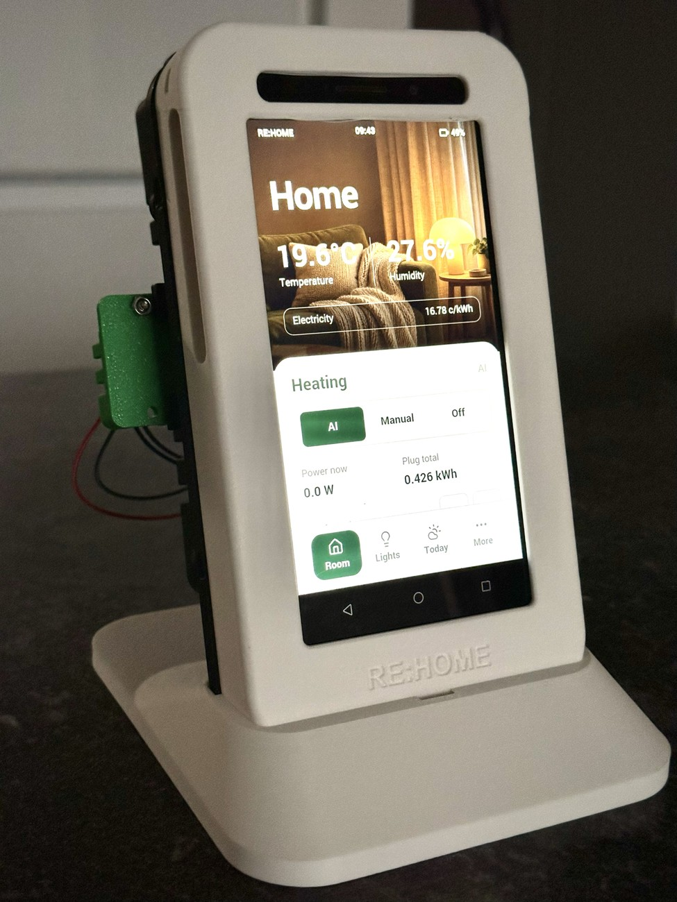
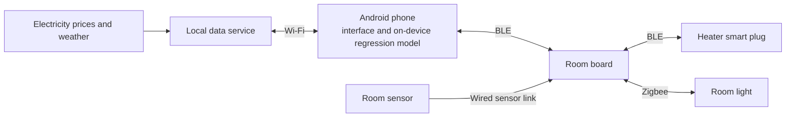

# RE:HOME

**Old phone. New purpose.** RE:HOME reuses a retired Android phone as a room controller for heating, lighting, and electricity-price information.

*The assembled RE:HOME prototype, photographed for the project summary submitted to May the Darkness Be With You 2026.*

🏆 **Future Impact Award** — RE:HOME won one of the two main awards at the University of Oulu’s [May the Darkness Be With You 2026](https://www.oulu.fi/fi/uutiset/may-darkness-be-you-2026) event.

## The idea

A phone that is no longer used as a phone still has a display, processor, and wireless connectivity. RE:HOME gives that device a useful second life: a dedicated interface for room conditions, heating and lighting controls, and electricity-price awareness.

## How the system connects

The phone brings together room readings and external data. The board connects the sensor and controlled devices. The regression model supports heating decisions on the phone; its formulas and parameters are not published here.

## Repository status

This is the public case study at the project’s original GitHub URL. The implementation is private; this repository contains no source code, build instructions, hardware configuration, or detailed control logic.

The original source repository was renamed and made private. This new public repository occupies `https://github.com/itsdaxen/RE-HOME` so existing links to the project landing page remain useful. Older links to individual source files or commits may no longer work. Please link to this page for the public project overview.

For questions about the project, open an issue in this repository.
